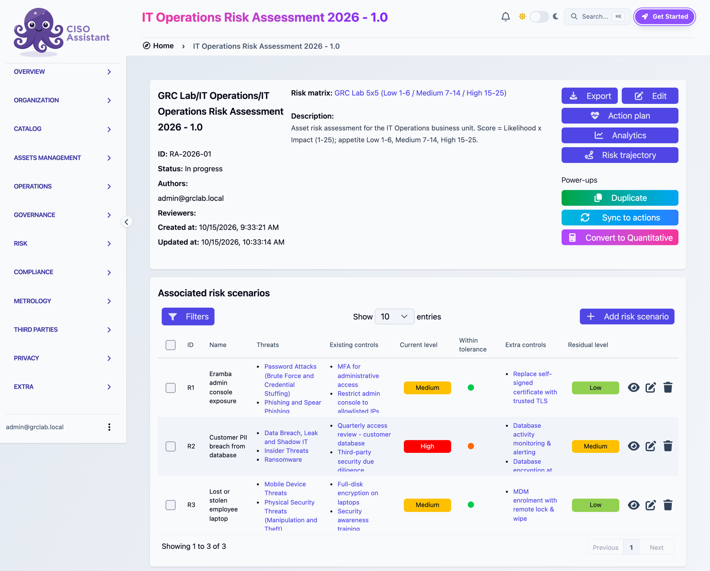
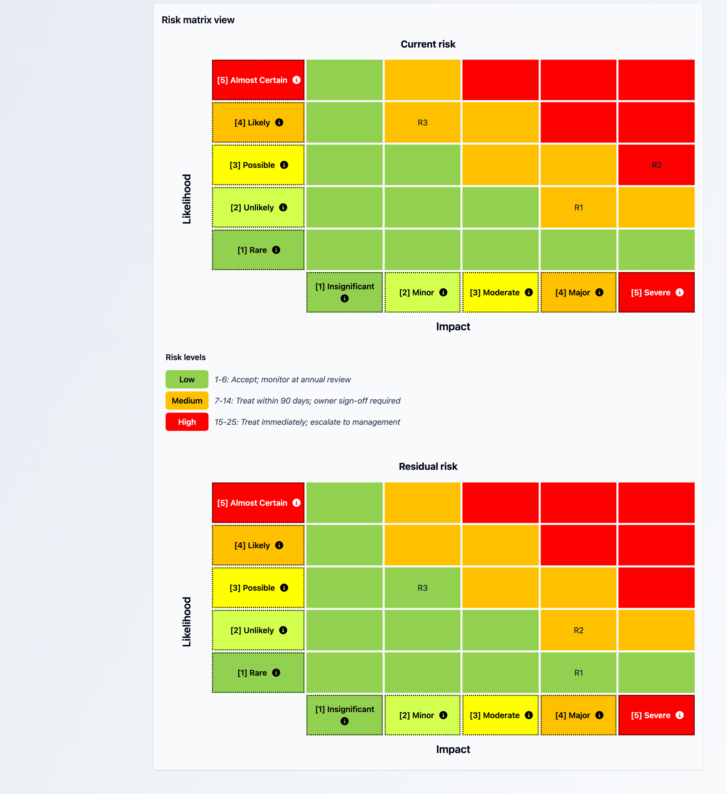
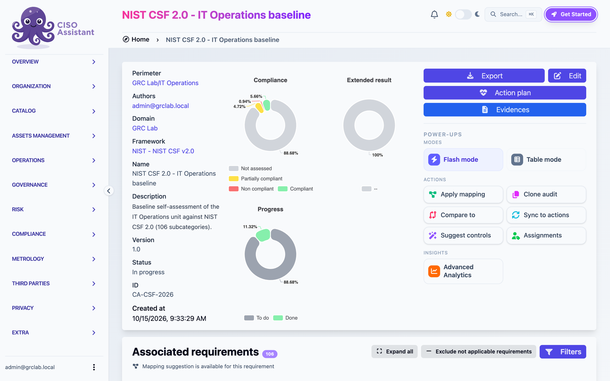
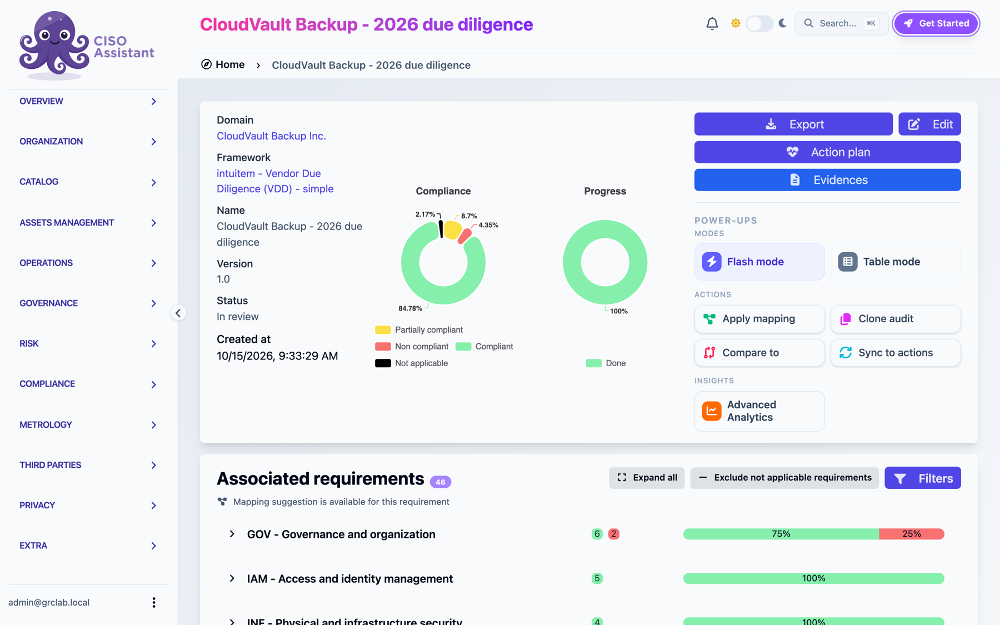
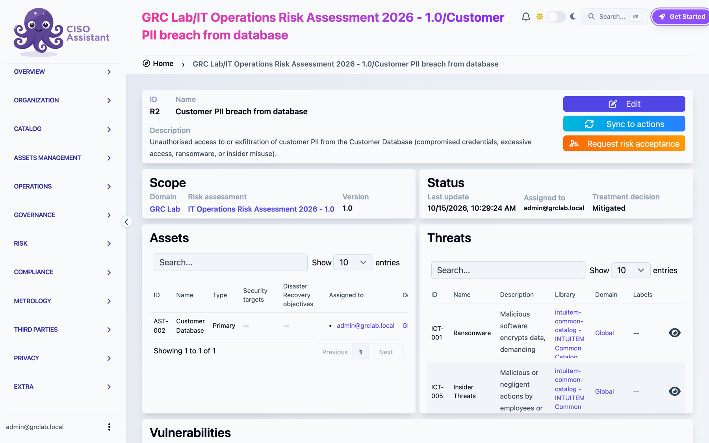
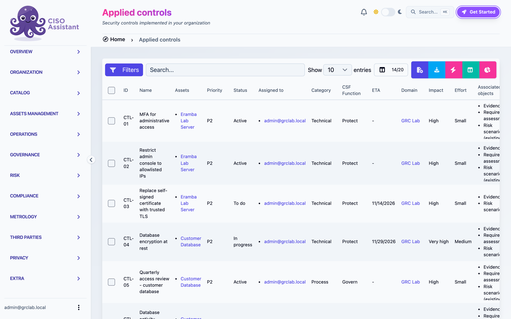
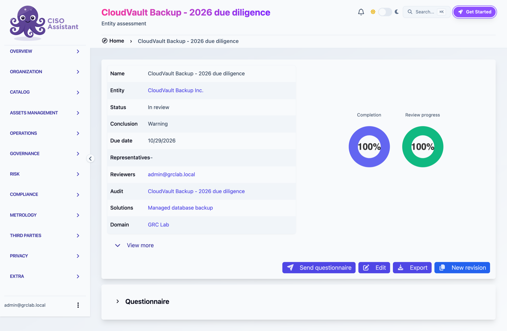
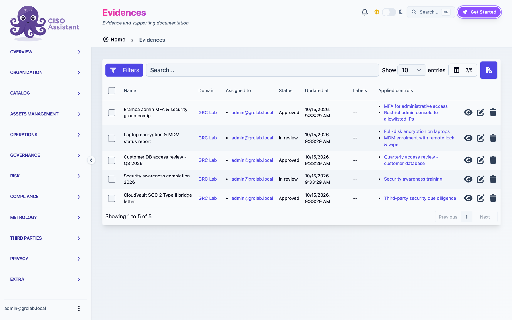
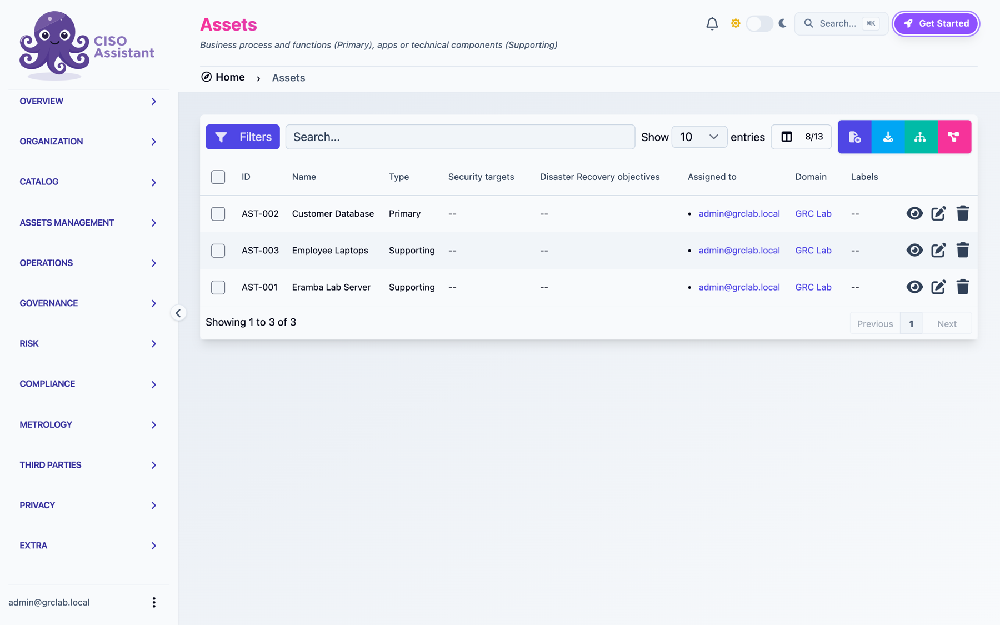

# GRC Program Lab: Risk, Compliance and Third-Party Risk

A hands-on governance, risk and compliance (GRC) program for a small IT Operations unit. It is built in two open-source GRC platforms: **Eramba**, self-hosted on AWS, and **CISO Assistant**.

It covers the core GRC work: framework adoption (NIST CSF 2.0), a defined risk methodology and appetite, a scored risk register, control mapping, evidence collection, and a vendor due-diligence review.

**Author:** Marie Haccandy, M.S. Cybersecurity Management · [LinkedIn](https://www.linkedin.com/in/marie-christine-haccandy-24b6b21ba) · [GitHub](https://github.com/mhacc001)

## At a glance

| Area | What was built |
|---|---|
| Framework | NIST CSF 2.0, all 106 subcategories, with 12 priority subcategories assessed and linked to controls and evidence |
| Risk method | 5x5 Likelihood x Impact (score 1-25). Appetite: **Low 1-6** accept, **Medium 7-14** treat within 90 days, **High 15-25** treat immediately |
| Risk register | 3 asset risks, each scored inherent, current and residual, with threats, treatment and rationale |
| Controls | 10 controls (technical and process) mapped to risks, assets and CSF functions, with status and due dates |
| Third-party risk | 46-question due-diligence review of a backup vendor plus SOC 2 bridge-letter review. 6 gaps found, conditional renewal |
| Evidence | 5 evidence artifacts with owners, review status and expiry dates, linked to controls and CSF subcategories |

## The scenario

**IT Operations** runs three assets:

- **Customer Database:** customer PII, the most sensitive data asset
- **Eramba Lab Server:** an AWS EC2 instance hosting the GRC tool itself
- **Employee Laptops:** company endpoints, some holding local copies of customer data

Nightly backups of the customer database go to a third-party SaaS provider, **CloudVault Backup Inc.** (a fictional vendor created for this lab).

## Risk register

| ID | Risk | Inherent | Current | Residual | Treatment |
|---|---|---|---|---|---|
| R1 | Eramba admin console exposure | 16 High | 8 Medium | 4 Low | Mitigate |
| R2 | Customer PII breach from database | 15 High | **15 High** | 8 Medium | Mitigate |
| R3 | Lost or stolen employee laptop | 12 Medium | 8 Medium | 6 Low | Mitigate |

- **Why R2 is still High:** access reviews are in place, but encryption at rest is not finished. Until it is, a breach would still have severe impact, so the current score stays at 15. That is outside appetite, and the item is escalated.
- **Why R1 dropped fast:** MFA and an IP allowlist on the admin console cut likelihood from Likely to Unlikely. A trusted TLS certificate removes the remaining phishing and man-in-the-middle path.
- **Why R3 drops:** full-disk encryption lowers impact from Moderate to Minor. One unencrypted laptop (LT-005) is tracked as a known gap in the evidence.

Full detail, including threats, controls and rationale for each risk: [docs/risk-register.md](docs/risk-register.md)

## Controls and NIST CSF 2.0

The 10 controls cover all three assets, from MFA and network allowlisting to encryption, quarterly access reviews, MDM and awareness training. Each control is mapped to a CSF function and to the risks it reduces. See [docs/controls.md](docs/controls.md).

Twelve CSF 2.0 subcategories were assessed against those controls. Results: 6 compliant, 5 partially compliant, 1 non-compliant. The non-compliant one is DE.CM-03: there is no monitoring of database activity yet. See [docs/nist-csf-assessment.md](docs/nist-csf-assessment.md).

## Vendor due diligence: CloudVault Backup (simulated)

- **Scope:** 46 questions across governance, IAM, application security, backup, incident response, infrastructure and SDLC, plus a review of the vendor's SOC 2 Type II bridge letter.
- **Result:** 39 yes, 4 partial, 2 no, 1 N/A.
- **Key findings:**
  - No sub-processor list provided (GOV.06)
  - No cyber insurance (GOV.08)
  - No incident-response tabletop in 12 months, which matches the SOC 2 exception CC7.4
  - Restore testing not contractually committed
  - Breach notification commitment vaguer than the 72 hours we require
- **Decision:** **Warning.** Approve renewal, with the gaps written into the contract as remediation items due by Q1 2027.

See [docs/vendor-assessment.md](docs/vendor-assessment.md).

## How it was built

**Phase 1: Eramba on AWS (configured by hand)**
- Deployed Eramba on an EC2 instance
- Imported NIST CSF 2.0 as a compliance package from a 106-row CSV ([lab/eramba-nist-csf-2.0-import.csv](lab/eramba-nist-csf-2.0-import.csv))
- Created the IT Operations business unit and its 3 assets
- Configured 5x5 likelihood and impact classifications with multiplication scoring

**Phase 2: CISO Assistant (built as code)**
- Ran CISO Assistant community edition locally
- Defined the same risk method as a custom library: [lab/libraries/risk-matrix-5x5-grclab.yaml](lab/libraries/risk-matrix-5x5-grclab.yaml)
- Built the full program with one repeatable script: [lab/build_lab.py](lab/build_lab.py). It creates the assets, controls, risks, CSF assessment, vendor review and evidence. Running it again updates records instead of duplicating them, so the program can be rebuilt or changed consistently.
- Exported the records in [docs/](docs/) with [lab/export_docs.py](lab/export_docs.py)

The evidence files are in [lab/evidence/](lab/evidence/): an MFA and security-group config record, a laptop encryption report, an access review sign-off, training completion records, and the vendor bridge letter. The evidence data is lab-generated, and the vendor is fictional.

## More screenshots

| | |
|---|---|
|  |  |
|  |  |
|  | |

## Tools and frameworks

Eramba · CISO Assistant · NIST CSF 2.0 · SOC 2 · AWS EC2 · Python / Django ORM · risk assessment · third-party risk management · control mapping · evidence management
